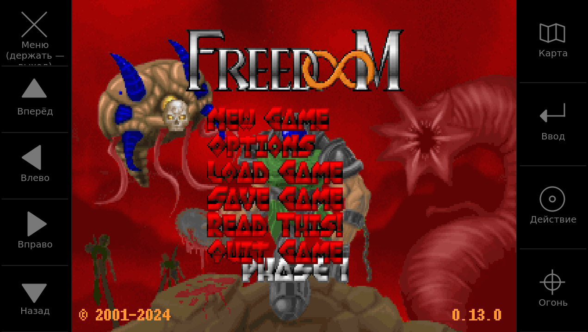
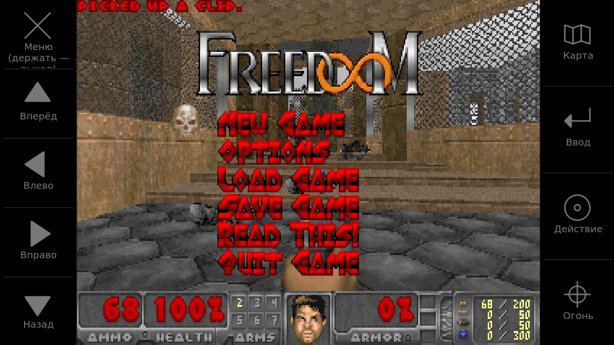
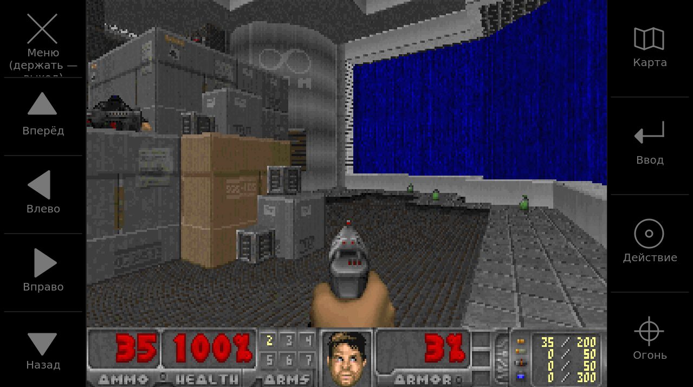

# doom-meego v1.1

**Неофициальный порт DOOM для ШГУ Hyundai Genesis (LG DHAVN, MeeGo IVI, i686, Qt 4 / X11).**  
*Unofficial DOOM port for the Hyundai Genesis head unit.* — [English below](#english)

> ⚠️ Неофициальный проект, не связан с Hyundai, Genesis, LG или id Software. Всё на свой риск.  
> В репозитории **нет** прошивки, ключей Hyundai/LG и WAD-файлов.

## Скриншоты / Screenshots

| Главное меню / Title menu | Меню в игре / In-game menu | Игра / Gameplay |
|---|---|---|
|  |  |  |

Картинка 960×720 по центру, по бокам — сенсорные зоны с подписями. / 960×720 picture in the centre, labelled touch zones on the side bars.

---

## Русский

### Возможности v1.1

- Звук ALSA, 48 кГц стерео S16: первое открывшееся устройство из `main_mix2` → `media_mixer` → `default` (если устройство не даёт ровно 48 кГц, это пишется в журнал — высота звука тогда будет немного другой)
- Музыка на эмуляторе **Nuked OPL3** v1.8 (режим OPL3, 18 голосов, чип 49716 Гц → 48 кГц, инструменты GENMIDI из WAD; MUS через mus2mid)
- Картинка **960×720 (4:3)** по центру экрана 1280×720, гамма 2
- Сенсорные зоны только на боковых чёрных полосах, с подписями и значками (слева: Меню / Вперёд / Влево / Вправо / Назад; справа: Карта / Ввод / Действие / Огонь)
- Управление шайбой (jog), кнопками панели и руля
- **Автовозврат** после звонка / камеры заднего вида: пауза и тишина на время прерывания, затем Doom сам возвращается на экран
- Чёрный экран при запуске (без белой вспышки)
- **Новое в v1.1:** меню выбора игры, если рядом лежит несколько IWAD (Freedoom 1/2, Doom, Doom II, Final Doom, Chex Quest); последний выбор запоминается в `doom_last_wad.txt`
- **Новое в v1.1:** кнопки всегда отдаются системе при любом выходе (обычный выход, BACK/HOME, сигнал, сбой), при скрытии и потере фокуса (звонок, камера, системное окно); при возврате — повторный захват. Устройства ввода открываются с `O_CLOEXEC`, нажатые клавиши сбрасываются
- **Новое в v1.1:** журнал по умолчанию выключен; включается файлом `doom_log_on.txt` рядом с WAD/программой (или `DOOM_LOG=1`)
- **Новое в v1.1:** работа из папки `game\doom-meego\` сборки Genesis-Updater (WAD рядом с программой)

### Что скачать пользователю

1. **Готовый пакет** из [Releases](https://github.com/SlayerSS/doom-meego/releases) — выберите свой вариант:
   - `doom-meego-v1.1-DH_2015.zip` — автомобили **DH, 2015** (`DH.EUR.SOP.10.017`)
   - `doom-meego-v1.1-DHPE_2018.zip` — автомобили **DHPE, 2018** (`DHPE.EUR.SOP.10.017`)
2. **Только WAD** (игра сама по себе): `freedoom1.wad` (Freedoom Phase 1) с  
   https://freedoom.github.io/download.html  

Больше ничего собирать не нужно. Бинарник Doom в обоих zip одинаковый; отличается только `.lge.upgrade.xml`.

Магнитола показывает обновление **только** если `version` в XML совпадает с типом ШГУ. Неверный zip — обновления на экране не будет.

### Установка (пошагово)

1. Карта SD, формат **FAT32**.
2. Распакуйте нужный zip.
3. Скопируйте **содержимое** zip в **корень** карты (не во вложенную папку):
   - `AppUpgrade`
   - `.lge.upgrade.xml`  
   Имя `AppUpgrade` **не менять**. На Windows файл `.lge.upgrade.xml` может быть скрытым — включите показ скрытых файлов.
4. Скачайте `freedoom1.wad` и положите в **тот же корень**, рядом с `AppUpgrade`. Можно и в папку `doom-meego\` — она уже есть в zip (пустая, с подсказкой `положите_сюда_WAD.txt`). Несколько WAD → меню выбора игры.
5. Вставьте карту → подтвердите найденное обновление (**OK**) → запускается Doom.

**Дерево на карте (плоско, без папок)**
```
\
├── .lge.upgrade.xml
├── AppUpgrade          ← Doom (из Releases)
├── doom-meego\         ← папка для WAD (из zip)
└── freedoom1.wad       ← скачать отдельно
```

### Если не работает

| Симптом | Что проверить |
|---------|----------------|
| Обновление не находится | DH vs DHPE; FAT32; файлы в корне; скопирован скрытый `.lge.upgrade.xml` |
| «Не найден WAD-файл…» | `freedoom1.wad` в корне карты рядом с `AppUpgrade` |
| Нет / тихий звук | Активный медиа-источник (Jukebox); с радио часто тихо — ограничение ШГУ |

### Управление

| Ввод | Действие |
|------|----------|
| Шайба: наклон | Ход / поворот |
| Шайба: нажатие | Огонь / Enter |
| Шайба: долгое нажатие | «Использовать» |
| BACK | Esc / назад; долгое — выход |
| HOME | Пауза / продолжить (продолжение поднимает Doom на экран) |
| MAP | Карта |
| MENU / PHONE | Следующее / предыдущее оружие |
| NAV | Огонь (держать); в меню Enter |
| SETUP | «Использовать»; в меню Enter |
| Руль: принять вызов | Огонь (держать — очередь) |
| Руль: завершить вызов | «Использовать» |
| Руль: джойстик вверх / вниз | Следующее / предыдущее оружие |
| Руль: MODE | Карта |
| Руль: голосовое управление | Пауза / продолжить |
| Сенсор, левая чёрная полоса (сверху вниз) | «Меню» = Esc (держать 2 с — выход) / «Вперёд» / «Влево» / «Вправо» / «Назад» |
| Сенсор, правая чёрная полоса (сверху вниз) | «Карта» / «Ввод» = Enter / «Действие» = использовать / «Огонь» |

Кнопки панели и руля читаются напрямую с устройства кнопок MICOM (`/dev/input`), Doom захватывает его, пока он на экране, поэтому кнопки руля не уходят в телефон и другие приложения. Вращение шайбы/TUNE приходит от UI-менеджера: поворот (в меню — вверх/вниз), нажатие TUNE — «использовать».

Долгое BACK: ~1,5 с (кнопка панели) — выход. В меню выбора игры: шайба/стрелки — выбор, нажатие/NAV — играть, BACK — выход. При выходе, скрытии или звонке все кнопки сразу возвращаются системе. Сенсорные зоны по игровой картинке не работают.

Рядом с `AppUpgrade` на карте: `doom_log_on.txt` (пустой файл включает журнал `doom_log.txt`, по умолчанию журнал выключен); опционально `keys.txt` (переназначение кнопок). `keys.txt` ищется рядом с `AppUpgrade`, затем `/navi/keys.txt`.

WAD ищется: рядом с `AppUpgrade` → в текущем каталоге → в подпапке `doom-meego/` → `/media/*/doom-meego`, `/mnt/*/doom-meego` → корни смонтированных носителей. Имена по порядку: `freedoom1.wad`, `doom.wad`, `doom1.wad`, `freedoom2.wad`, `doom2.wad`, затем любой `*.wad`.

### Технические детали

- Evdev + `EVIOCGRAB` (отпускается при скрытии / выходе / SIGTERM)
- ALSA через `libasound` (dlopen): 48 кГц, период 960 кадров, программный микшер звуков с линейной интерполяцией и мягким лимитером; музыка Nuked OPL3 (LGPL-2.1+, `src/opl3.c`) смешивается в том же потоке
- Картинка 960×720 (320×200: ×3 по горизонтали, строки 4,4,3,4,3), по центру 1280×720 с чёрными полосами 160 px; сенсорные зоны только на полосах, касания по игре игнорируются; гамма по умолчанию 2
- Пауза и закрытие PCM при потере экрана; автовозврат окна после прерывания: сигналы UI-менеджера REQUEST_BG / REQUEST_FG / REQUEST_PRE_FG / REAR_GEAR_ENGAGED / REAR_GEAR_REMOVED (через Updater: «S 0»/«S 1»), плюс собственная проверка X11 (окно закрыто/скрыто → через 0,4 с пауза и тишина; без известного прерывания — повторный подъём окна через 3, 6, 12, 24, 48, затем ~96 с; любое нажатие поднимает сразу)

### Сборка (разработчикам)

```sh
sudo ./scripts/build-i686.sh --bootstrap   # один раз
sudo ./scripts/build-i686.sh               # DOOM_OK → builds/DH_2015 и builds/DHPE_2018
```

Скрипт кладёт один бинарник в обе папки и копирует XML из `card/`. Бинарники в git не хранятся (`bin/` в `.gitignore`) — они публикуются как файлы релиза.  
Тест на ПК (Qt 5): `qmake doom-meego.pro && make && ./doom-meego -iwad freedoom1.wad`.

Шаблоны XML: `card/DH_2015/`, `card/DHPE_2018/`.

### Отладка на ШГУ

```sh
cp /media/<карта>/AppUpgrade /tmp/doom && chmod +x /tmp/doom
cd /media/<карта>
/tmp/doom -iwad freedoom1.wad 2>> doom_log.txt
```

### Автор

**SlayerSS**, Copyright (C) 2026. GPL-2.0 — `LICENSE`. См. также `CREDITS.md`.

---


## English

### Features (v1.1)

- ALSA sound, 48 kHz stereo S16: first device that opens of `main_mix2` → `media_mixer` → `default` (a non-48 kHz device is only logged; pitch would then differ)
- Music via the **Nuked OPL3** v1.8 emulator (OPL3 mode, 18 voices, 49716 Hz chip resampled to 48 kHz, GENMIDI instruments from the WAD)
- **960×720 (4:3)** picture centred on the 1280×720 screen, gamma 2
- Touch zones only on the black side bars, with labels and icons (left: Menu / Forward / Left / Right / Back; right: Map / Enter / Use / Fire; labels are in Russian)
- Jog dial, panel and steering-wheel buttons
- **Auto-return** after a phone call / rear camera: paused and muted during the interrupt, then Doom comes back to the screen by itself
- Black startup screen (no white flash)
- Auto-return logic: UI-manager REQUEST_BG/FG/PRE_FG and REAR_GEAR events (via Genesis-Updater), plus an X11 watchdog: pause+mute 0.4 s after the window is covered; with no known interrupt it re-raises after 3, 6, 12, 24, 48, then ~96 s; any key press re-raises at once

### New in v1.1

- IWAD selection menu when several IWADs sit next to the chosen one (Freedoom 1/2, Doom, Doom II, Final Doom, Chex Quest); last choice remembered in `doom_last_wad.txt`
- Keys are always given back to the system on any exit (normal, BACK/HOME, signal, crash), on hide and on focus loss (call, camera, system overlay), and re-grabbed on return; input devices opened with `O_CLOEXEC`; held keys reset
- Logging is off by default; enable with `doom_log_on.txt` next to the WAD/binary (or `DOOM_LOG=1`)
- Runs from the Genesis-Updater `game\doom-meego\` folder (WAD next to the binary)

### What to download

1. A package from [Releases](https://github.com/SlayerSS/doom-meego/releases):
   - `doom-meego-v1.1-DH_2015.zip` — **DH, 2015** (`DH.EUR.SOP.10.017`)
   - `doom-meego-v1.1-DHPE_2018.zip` — **DHPE, 2018** (`DHPE.EUR.SOP.10.017`)
2. **WAD only**: `freedoom1.wad` (Freedoom Phase 1) from  
   https://freedoom.github.io/download.html  

No build step for end users. The Doom binary is the same in both zips; only `.lge.upgrade.xml` differs.

The head unit shows an update **only** if `version` matches the unit type.

### Install

1. FAT32 SD card.  
2. Unzip the matching release.  
3. Copy **its contents** to the **card root**: `AppUpgrade`, `.lge.upgrade.xml` (do not rename `AppUpgrade`; on Windows enable hidden files for `.lge.upgrade.xml`).  
4. Put `freedoom1.wad` in the **same root**. Or into the `doom-meego\` folder already included in the zip (empty, with a hint file). Several WADs → game selection menu.  
5. Insert the card → confirm update (**OK**) → Doom starts.

```
\
├── .lge.upgrade.xml
├── AppUpgrade
└── freedoom1.wad
```

### Troubleshooting

| Symptom | Check |
|---------|--------|
| Update not detected | DH vs DHPE; FAT32; files in root; hidden `.lge.upgrade.xml` copied |
| On-screen WAD message | Place `freedoom1.wad` in the card root next to `AppUpgrade` |
| No / quiet sound | Use a media source (e.g. Jukebox); radio path is often silent |

### Controls

| Input | Action |
|-------|--------|
| Jog tilt | Move / turn |
| Jog press | Fire / Enter |
| Jog long press | Use |
| BACK | Esc / back; long = quit |
| HOME | Pause / resume (resume brings Doom back to the front) |
| MAP | Automap |
| MENU / PHONE | Next / previous weapon |
| NAV | Fire (hold); Enter in menus |
| SETUP | Use; Enter in menus |
| Wheel: call send | Fire (hold = auto) |
| Wheel: call end | Use |
| Wheel: stick up / down | Next / previous weapon |
| Wheel: MODE | Automap |
| Wheel: voice | Pause / resume |
| Touch, left black bar (top to bottom) | "Меню" = Esc (hold 2 s = quit) / forward / turn left / turn right / back |
| Touch, right black bar (top to bottom) | Automap / Enter / use / fire |

Panel and steering-wheel keys are read directly from the MICOM key device (`/dev/input`), grabbed while Doom is in front, so wheel keys do not reach the phone or other apps. Jog/TUNE rotation comes from the UI manager: turn (up/down in menus), TUNE press = use. Panel BACK held ~1.5 s quits. IWAD menu: jog/arrows = select, press/NAV = play, BACK = quit. On exit, hide or call every key is handed back to the system at once.

WAD lookup: next to `AppUpgrade`, current dir, `doom-meego/` subfolder, `/media/*/doom-meego`, `/mnt/*/doom-meego`, mounted roots; names `freedoom1.wad`, `doom.wad`, `doom1.wad`, `freedoom2.wad`, `doom2.wad`, then any `*.wad`. Optional files next to `AppUpgrade`: `doom_log_on.txt` (empty file, enables the `doom_log.txt` log; off by default), `keys.txt` (key remap; also `/navi/keys.txt`).

### Build

```sh
sudo ./scripts/build-i686.sh
```

Desktop (Qt 5): `qmake doom-meego.pro && make && ./doom-meego -iwad freedoom1.wad`.  
Binaries are not kept in git (`bin/` is ignored); they are published as release assets. See `CHANGELOG.md`.

### Author

**SlayerSS**, GPL-2.0. See `LICENSE` and `CREDITS.md`.
